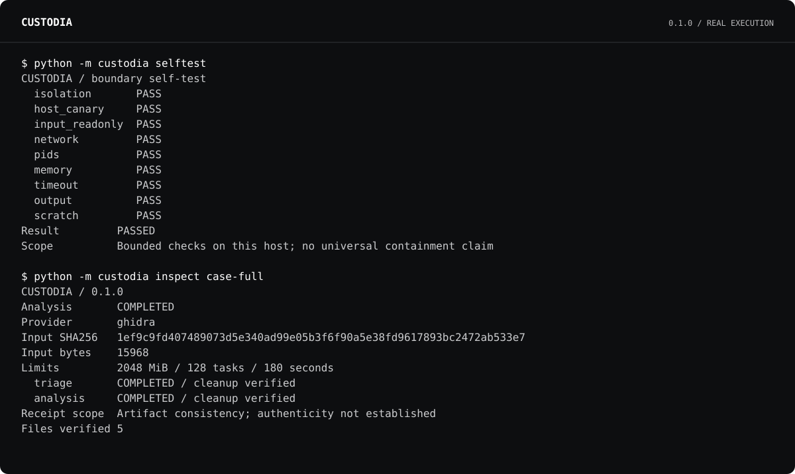

# CUSTODIA

**Inspect the sample. Keep the boundary.**

A terminal laboratory for static binary analysis on Linux. Give Ghidra an input, a finite resource budget, and a filesystem it can use. Get bounded findings, an explicit completion state, and a portable receipt you can check later.

**0.1.0 technical preview.** The isolation backend, Ghidra adapter, receipts, retries, and boundary probes are implemented. This is an early security tool with a deliberately narrow supported configuration. Read the [security model](docs/SECURITY.md) before analyzing hostile material.



## Why this exists

A reverse-engineering parser processes attacker-controlled bytes. Moving it into a subprocess does not by itself hide your home directory, remove network access, or constrain all its children. A timeout message also does not tell you which findings survived.

CUSTODIA makes those boundaries explicit. It verifies the actual cgroup controls **before the parser starts**, uses a separate network and filesystem view, and records the difference between a completed analysis, a partial report, a resource termination, and unverified cleanup. If the required controls are unavailable, it refuses to analyze the input.

| You need | CUSTODIA provides |
| --- | --- |
| A parser that cannot browse your working directory | Fixed read-only input/tool mounts; isolated home; no host network |
| Limits that cover child processes | Aggregate memory and process ceilings, CPU rate, wall deadline, bounded scratch and output |
| Useful static findings | Header observations, entropy and ASCII strings; optional Ghidra functions, symbols, sections and selected decompiled C |
| An honest result after failure | Explicit status, retained completed triage, provider partial reports when available |
| A repeatable investigation | Input snapshot, tool and policy identities, verified retries, comparison of exported function samples |
| Evidence that controls work here | Nine bounded, executable boundary checks on your own machine |

It uses Ghidra's analyzers. It does not claim to improve their decompilation accuracy, certify a binary as safe, or contain every kernel exploit. A receipt establishes recorded artifact consistency, **not authenticity or correctness of the analysis**.

## Try it

Requires Linux, Python 3.11+ **both for the CLI and `/usr/bin/python3`**, systemd 254+ with a functioning user manager and delegated cgroup v2 controllers, and bubblewrap with the required namespace and size-limited tmpfs flags. Run as a normal user. The reference host used systemd 255.4 and bubblewrap 0.9.0. See [supported boundaries and troubleshooting](docs/BOUNDARIES.md).

Install from this repository in a virtual environment, or install a wheel from [Releases](https://github.com/artifexignotvs/custodia/releases). There are no third-party Python runtime dependencies.

```sh
git clone https://github.com/artifexignotvs/custodia.git
cd custodia
python3 -m venv .venv
. .venv/bin/activate
python -m pip install .

custodia doctor
custodia selftest
custodia demo --out case-demo
custodia inspect case-demo
custodia verify case-demo
```

The demo is a built-in synthetic byte sample. It performs real isolated triage; it does not simulate a Ghidra run. Every output directory must be new.

## Analyze a binary

For byte statistics and bounded format-header observations:

```sh
custodia run sample.bin --out case-001
```

For Ghidra analysis, supply dedicated trusted **Ghidra 12.1.4** and **full JDK 21** distributions:

```sh
custodia run sample.bin --out case-002 \
  --ghidra-home /path/to/ghidra_12.1.4_PUBLIC \
  --java-home /path/to/jdk-21
custodia inspect case-002
custodia show case-002 --section functions --limit 20
custodia show case-002 --section decompile
custodia verify case-002 --json
```

The input is imported, never launched by CUSTODIA. The snapshot is limited to 128 MiB. The default policy allows 2 GiB aggregate memory, 128 tasks, one CPU worth of processing rate, 180 seconds for the analysis stages, 512 MiB scratch, and 8 MiB captured output. Preflight, snapshot copying, tool hashing and cleanup are outside that analysis budget.

The Ghidra export is intentionally bounded: up to 1,000 internal functions and three selected decompilations by default, with visible truncation and timeout information. Read the [provider guide](docs/GHIDRA.md) for download verification, limits, report semantics, and a benign C fixture you can compile yourself.

## Control, retry, compare

```sh
custodia policy > policy.json
# Edit explicit limits in policy.json, then:
custodia run sample.bin --out case-custom --policy policy.json

custodia retry case-001 --out case-retry
custodia compare case-001 case-retry
custodia compare case-001 case-retry --json
```

Ghidra retries also require the two tool-directory arguments. A retry always creates a separate session and records its parent's receipt digest. It can reuse completed triage only when the input, engine, policy and tool identities match. Ghidra analysis runs again. Changing the policy or toolchain prevents reuse. There is no promise that a second run produces byte-identical evidence on every input.

`compare` reports input, policy, engine and tool identity changes, status changes, and additions/removals in the exported function-name sample. It is not a semantic diff of the whole program or a vulnerability detector.

## What stays on disk

Each session is a private directory containing a non-executable input snapshot, completed findings, diagnostics, `receipt.json`, and `SHA256SUMS`. Artifacts are written without overwriting existing paths. Data is local plaintext; input bytes, extracted strings, decompiled code and logs may be sensitive. Nothing is uploaded by the analysis tool. Review a bundle before sharing it.

`verify` checks bounded schemas, the declared input identity, file hashes, expected files, completion consistency, and recorded controls against the policy. It does not rerun the analysis. An attacker who can rewrite the entire bundle can generate a new internally consistent bundle; retain the receipt digest in an independently trusted record when provenance matters.

| Exit | Meaning |
| --- | --- |
| `0` | Requested operation succeeded; analysis completed, or artifact consistency verified |
| `2` | Invalid input, policy, session, unavailable preflight, or local operation error |
| `3` | Analysis/self-test did not complete successfully; inspect the recorded status |
| `4` | `doctor`/self-test reports unavailable controls, or a run loses its available boundary |
| `130` | Interrupted |

A successful `verify` can describe an accurately recorded **failed** analysis. Consistency and analysis success are different fields.

## Tested, with scope

The release validation uses actual Linux isolation, not mocked resource limits. Tests cover hidden host canaries, immutable input, network isolation, capabilities, bounded aggregate memory and task counts, scratch exhaustion, bounded output, detached-child termination, and interruption cleanup. Portable unit tests separately cover malformed receipts, tampering, unsafe files, retry identity changes, and contradictory completion records.

The included benign C fixture was analyzed both directly and inside CUSTODIA with the same pinned Ghidra/JDK toolchain. Every exported report field matched, including the three selected decompiled C bodies. Additional runs exercised a two-function cap and a genuine Ghidra auto-analysis timeout. This is evidence for those tested cases, not a universal equivalence claim.

See [validation and reproduction](docs/VALIDATION.md). Hosted CI runs portable tests and installed-package checks; it does not substitute for the live boundary and external-toolchain tests.

## Contribute a concrete failure

A useful report includes the version, `doctor --json`, `selftest --json`, the policy, and a minimized non-sensitive reproducer. Never attach a confidential specimen or an unreviewed session. See [CONTRIBUTING](CONTRIBUTING.md) and [security reporting](SECURITY.md).

MIT licensed. Ghidra and Java are external dependencies with their own licenses. No affiliation or upstream endorsement is implied.

*Fines ante fiduciam — boundaries before trust.*
